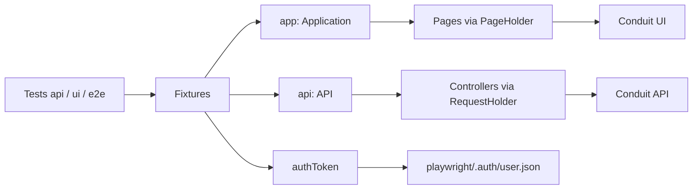

# Conduit Test Automation

Playwright and TypeScript framework for the [Conduit (RealWorld)](https://demo.realworld.show/) demo. API tests check the contract. UI tests check the signed-in and signed-out journeys. Hybrid tests create data through the API and assert it in the browser.

The target UI is `https://demo.realworld.show`. The API is `https://api.realworld.show/api`.

## Tech stack

| Tool                    | Role                                                                 |
| ----------------------- | -------------------------------------------------------------------- |
| Playwright 1.64         | Browser automation, `APIRequestContext` clients, HTML report, traces |
| TypeScript              | Strict models for requests, responses, pages, and fixtures           |
| Page Object Model       | `PageHolder` base, `Application` aggregator                          |
| Allure                  | `allure-playwright` results and an HTML report                       |
| Faker                   | Unique users and articles                                            |
| ESLint, Prettier, Husky | Local quality gate, also run in CI                                   |

API calls use Playwright's request API. There is no separate HTTP client.

## Architecture



`globalSetup` registers one user, signs in, and writes `playwright/.auth/user.json`. Every browser project loads that file as `storageState`. The `authToken` fixture reads the same token, so the browser and the API act as one author. This demo returns an article only to the user who created it.

Authentication UI tests clear that storage and start signed out. One of them injects the registration token into `localStorage` under `jwtToken` before opening the home page. That is the key this frontend reads.

## Principles

**Assertions stay in tests.** Page objects expose locators, actions, waits, and getters. They do not call `expect`. A test step named `Assert` reads those values and checks them.

**The API prepares data.** Article flows create and delete articles through `api.articles`. The UI path stays short. `DataGenerator` builds a unique title, body, and user for each run.

**Status codes are part of the contract.** Create expects `201`, read and update expect `200`, and delete expects `204`. A deleted article is then fetched again. `getArticle` accepts only `200`, so the test expects that call to fail with `404`.

**Navigation is centralized.** `app.navigateTo` is the only `page.goto`. Routes live in `Urls`. Article and editor slugs are built on the page objects.

## Project structure

```text
src/
  api/
    api.ts                 auth, articles, and comments
    request-holder.ts      status checks and JSON parsing
    controllers/           one controller per resource
    models/                request and response types
  config/env.config.ts     typed BASE_URL, API_URL, and credentials
  constants/urls.enum.ts   application routes
  fixtures/test.fixture.ts app, api, authToken, createArticle
  pages/
    page-holder.ts         shared page and navigateTo
    application.ts         home, login, editor, and article pages
  support/global-setup.ts  one login and the storageState file
  tests/
    api/                   article CRUD
    ui/                    login validation, sign-in, token injection
    e2e/                   hybrid article create and publish
  utils/
    data-generator.ts      faker payloads
    string.helper.ts       title to slug and article path
.github/workflows/         quality gate, Playwright, Allure
playwright/.auth/          generated session, not committed
```

## Setup

Node.js 20 or newer.

```bash
git clone <repository-url>
cd RS_autotests
npm ci
cp .env.example .env
npx playwright install --with-deps
```

| Variable        | Guideline                                                                                        |
| --------------- | ------------------------------------------------------------------------------------------------ |
| `USER_EMAIL`    | Required and non-empty. The suite registers its own user and does not sign in with this address. |
| `USER_PASSWORD` | Required and non-empty. It is not sent as the login password.                                    |
| `BASE_URL`      | Optional. Defaults to `https://demo.realworld.show`.                                             |
| `API_URL`       | Optional. Defaults to `https://api.realworld.show/api`.                                          |
| `ENVIRONMENT`   | `dev` or `staging`. Defaults to `dev`.                                                           |

## Execution

| Command                    | What it runs                              |
| -------------------------- | ----------------------------------------- |
| `npm run test:api`         | Article CRUD under `src/tests/api`        |
| `npm run test:ui-only`     | Authentication flows under `src/tests/ui` |
| `npm run test:e2e:article` | Hybrid article flow                       |
| `npm run test:e2e`         | The full suite, headless                  |
| `npm run test:ui`          | Playwright UI mode                        |
| `npm run test:headed`      | Headed browsers                           |
| `npm run quality:check`    | `tsc --noEmit`, ESLint, and Prettier      |

Projects are Chromium, Firefox, and WebKit. Add `--project=chromium` to run one browser. CI retries failed tests twice and uses one worker. Local runs do not retry.

### Allure

The Playwright config writes `allure-results` on every run.

```bash
npm run test:allure
```

That command runs the suite, builds `allure-report`, and opens it. The separate commands are `npm run allure:generate`, `npm run allure:open`, and `npm run allure:clear`. `npm run report:show` opens the Playwright HTML report.

## CI

`.github/workflows/playwright.yml` runs on push and pull request to `main` and `master`, and on manual dispatch.

On `ubuntu-24.04` with Node 20 it installs dependencies, runs `npm run quality:check`, installs Playwright browsers, and runs the suite. Ubuntu 24.04 is pinned because this Playwright version's WebKit needs `libicu74`. A TypeScript, ESLint, Prettier, or test failure fails the job. Traces, the Playwright report, and the Allure report are uploaded as artifacts for 14 days. On a push to `main` or `master`, the Allure report is also published to the `gh-pages` branch. Pull requests do not publish that branch.
