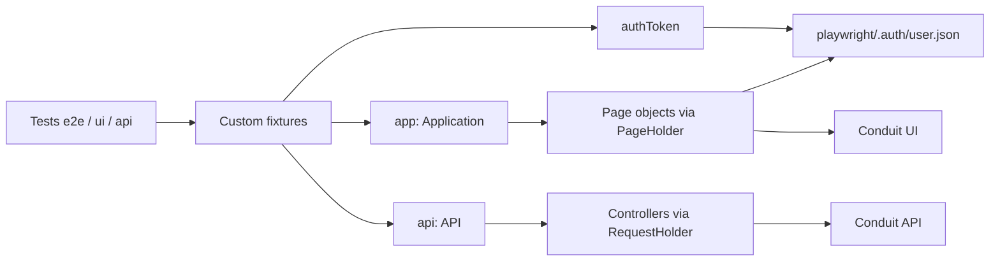

# Conduit Test Automation

Playwright and TypeScript framework for hybrid UI and API testing of [Conduit (RealWorld)](https://demo.realworld.show/).

API calls seed and clean data. UI tests verify the signed-in journey. One global login is reused through Playwright `storageState`.


## Architectural highlights

**Hybrid testing.** Tests create articles through the API, then assert the same data in the browser. Cleanup goes through the API as well, so the UI path stays short.

**Fixtures and page objects.** `PageHolder` and `RequestHolder` own the Playwright `page` and `request`. Child pages and controllers declare fields only. Tests talk to two aggregators: `app` (`homePage`, `editorPage`) and `api` (`auth`, `articles`).

**Global auth.** `globalSetup` registers one user, stores `jwtToken` in `playwright/.auth/user.json`, and every browser project loads that file as `storageState`. The `authToken` fixture reads the same token, so API calls and the UI belong to one account. This demo only returns an article to its author.

**Data.** `@faker-js/faker` builds unique usernames, emails, and article titles inside `DataGenerator`.

**Teardown.** Specs do not wrap the body in `try/finally`. `test.afterEach` deletes the created article and records that step in the report.

## Architecture



## Directory structure

```text
src/
  api/
    api.ts                  API aggregator
    request-holder.ts       shared APIRequestContext
    controllers/            auth and articles
    models/                 request and response types
  config/env.config.ts      typed environment config
  fixtures/test.fixture.ts  app, api, authToken, createArticle
  pages/
    page-holder.ts
    application.ts          homePage and editorPage
  support/global-setup.ts   one-time login and storageState
  tests/
    e2e/                    hybrid UI + API flows
    ui/                     UI-only tests
    api/                    API-only tests
  utils/data-generator.ts
.github/workflows/          CI quality gates and Playwright
playwright/.auth/           generated session, not committed
```

## Prerequisites and setup

- Node.js 20. Node.js 18 is the minimum. CI uses 20.
- Copy `.env.example` to `.env`. `USER_EMAIL` and `USER_PASSWORD` must be set. The suite registers its own user and does not log in with those values. `BASE_URL` defaults to `https://demo.realworld.show`.

```bash
npm ci
npx playwright install --with-deps
```

## Scripts

| Script | What it does |
| --- | --- |
| `npm run test:e2e` | Headless Playwright run |
| `npm run test:ui` | Playwright UI mode |
| `npm run test:headed` | Headed browsers |
| `npm run test:e2e:article` | Hybrid article flow only |
| `npm run test:api` | Tests under `src/tests/api` |
| `npm run test:ui-only` | Tests under `src/tests/ui` |
| `npm run quality:check` | `tsc --noEmit`, ESLint, and Prettier check |
| `npm run test:allure` | Run tests, generate the Allure report, and open it |
| `npm run report:show` | Open the Playwright HTML report |
| `npm run allure:generate` | Build `allure-report` from `allure-results` |
| `npm run allure:open` | Open the generated Allure report |
| `npm run allure:clear` | Delete Allure result and report folders |

`npm run type-check`, `npm run lint`, and `npm run format:ci` are the individual quality commands.

## CI

`.github/workflows/playwright.yml` runs on push and pull request to `main`, on `ubuntu-latest`.

1. Restore the npm cache and the Playwright browser cache.
2. `npm ci` with Husky disabled.
3. `npm run type-check` and `npm run lint`. A TypeScript error or an ESLint error fails the job.
4. `npx playwright install --with-deps`, then a headless `npx playwright test`.
5. Upload `playwright-report/` and `test-results/` with `actions/upload-artifact@v4` after a successful or failed run. Traces, screenshots, and videos are included when a test fails.

The Allure reporter still writes `allure-results` during CI. The published artifact is the Playwright HTML report and traces. Generate the Allure HTML locally with `npm run allure:generate`.
